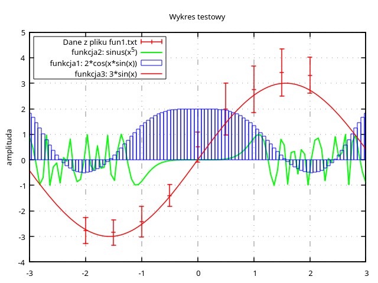
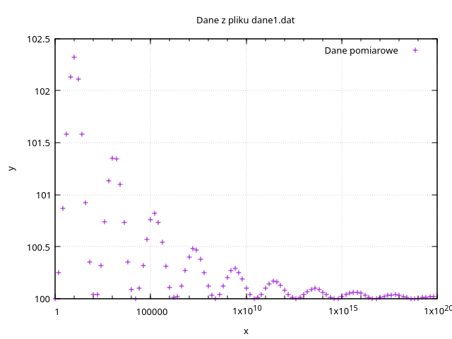
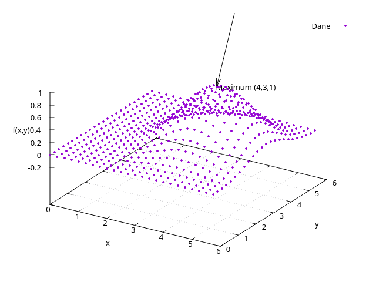

# Sprawozdanie

**Nr laboratorium:** 02  
**Temat:** Wstęp do biblioteki GSL oraz narzędzia GNUPLOT  
**Autor:** Maciej Bielewski  
**Data:** 8/10/2026

---

## 1. Co było do zrobienia

Celem laboratorium było zapoznanie się z biblioteką GSL (GNU Scientific Library), wykorzystywaną do obliczeń numerycznych w języku C, oraz z narzędziem Gnuplot, służącym do wizualizacji danych i funkcji matematycznych.

W ramach ćwiczenia należało wykonać cztery zadania:

1. Skompilować i uruchomić program dokladnosc.c, a następnie zbadać reprezentację liczb zmiennoprzecinkowych, w szczególności mantysę i wykładnik, dla coraz mniejszych wartości przy użyciu funkcji gsl_ieee_printf_double.
2. Odtworzyć wykres wzorcowy za pomocą Gnuplot, przedstawiający dane z pliku `fun1.txt` oraz trzy funkcje matematyczne.
3. Narysować wykres danych z pliku `dane1.dat` i zastosować skalę logarytmiczną na osi $x$, aby czytelniej przedstawić dane obejmujące szeroki zakres wartości.
4. Narysować wykres trójwymiarowy danych z pliku `dane2.dat`, znaleźć maksimum w zbiorze danych i zaznaczyć je na wykresie za pomocą strzałki.

## 2. Moje podejście do rozwiązania problemu

### 2.1. Badanie reprezentacji liczb zmiennoprzecinkowych

Pracę rozpoczęto od skompilowania i uruchomienia programu `dokladnosc.c`. Do kompilacji wykorzystano polecenie `make`, zgodnie z dostarczonym plikiem Makefile.

```bash
make
./dokladnosc
```

W programie wykorzystano funkcje `gsl_ieee_printf_float` oraz `gsl_ieee_printf_double`, które umożliwiają wyświetlenie reprezentacji liczb zmiennoprzecinkowych.

Pierwotny program porównywał trzy zmienne:

```c
float f = 1.0/3.0;
double d = 1.0/3.0;
double fd = f;
```

Celem porównania było zaobserwowanie różnic w precyzji typów `float` i `double`. W typowych implementacjach zgodnych ze standardem IEEE 754 typ `float` zapewnia 24 bity precyzji znaczącej, natomiast `double` — 53 bity. Liczba $1/3$ ma nieskończone rozwinięcie binarne, dlatego nie może być dokładnie reprezentowana w tych formatach.

Zmienna `f` przechowuje przybliżenie liczby $1/3$ zapisane jako `float`, natomiast `d` przechowuje jej przybliżenie zapisane jako `double`. Zmienna `fd` zawiera wartość `f` przekonwertowaną na typ `double`. Konwersja ta nie odzyskuje precyzji utraconej podczas wcześniejszego zaokrąglenia do typu `float`.

Następnie zmodyfikowano program, aby zbadać reprezentację bardzo małych liczb. Zastosowano funkcję `ldexp`, która pozwala obliczać wartości będące iloczynem liczby i potęgi liczby 2.

```c
#include <stdio.h>
#include <gsl/gsl_ieee_utils.h>
#include <math.h>

int main(void)
{
    double x;

    for (int i = 1020; i <= 1025; i++) {
        x = ldexp(1.0, -i);

        printf("2^-%d = ", i);
        gsl_ieee_printf_double(&x);
        printf("\n");
    }

    return 0;
}
```

Program generuje kolejne liczby od $2^{-1020}$ do $2^{-1025}$. Wybrany zakres obejmuje granicę między liczbami znormalizowanymi i podnormalnymi typu `double`.

Po wprowadzeniu zmian program ponownie skompilowano i uruchomiono:

```bash
make clean
make
./dokladnosc
```

Uzyskany wydruk pozwolił porównać mantysę oraz wykładnik dla kolejnych wartości. Szczególną uwagę zwrócono na zmianę reprezentacji między $2^{-1022}$ i $2^{-1023}$.

### 2.2. Odtworzenie wykresu wzorcowego

W drugim zadaniu wykorzystano Gnuplot do odtworzenia wykresu na podstawie pliku `fun1.txt` oraz trzech funkcji matematycznych.

Skonfigurowano wygląd wykresu, ustawiając grubość ramki, siatkę, legendę oraz zakres osi. Dane z pliku przedstawiono za pomocą czerwonych słupków błędów (`yerrorbars`), a trzy funkcje narysowano w różnych kolorach i stylach: \(\sin(x^5)\) zieloną linią, \(2\cos(x\sin(x))\) niebieskimi słupkami (`boxes`) oraz \(3\sin(x)\) czerwoną linią. Dzięki temu poszczególne serie są łatwe do rozróżnienia.

Poniżej przedstawiono końcowy skrypt zapisany w pliku `wynik_plot`.

```gnuplot
set border lw 1.5
set linetype 101 lc rgb "#888888" lw 1 dt (1, 15)
set grid lt 101
set key top left box lw 1

set title "Wykres testowy"
set ylabel "amplituda"

plot [-3:3][-4:5] \
    "fun1.txt" using 1:($2+$3)/2:2:3 \
        w yerrorbars lc rgb "red" lw 1.5 \
        title "Dane z pliku fun1.txt", \
    sin(x**5) \
        lc rgb "green" lw 2 \
        title "funkcja2: sinus(x^5)", \
    2*cos(x*sin(x)) \
        w boxes lc rgb "blue" \
        title "funkcja1: 2*cos(x*sin(x))", \
    3*sin(x) \
        lc rgb "red" lw 1.5 \
        title "funkcja3: 3*sin(x)"
```

Skrypt uruchomiono w Gnuplot za pomocą polecenia:

```gnuplot
load "wynik_plot"
```

### 2.3. Wykres danych z pliku `dane1.dat`

Trzecie zadanie polegało na przedstawieniu danych z pliku `dane1.dat`, zawierającego wyniki symulacji stygnięcia gwiazd neutronowych.

Plik zawiera dwie kolumny: pierwsza reprezentuje współrzędną $x$, a druga wartość $y$. Współrzędna $x$ zmienia się od $1$ do około $6{,}31 \cdot 10^{19}$, natomiast wartości $y$ mieszczą się w przedziale od $100$ do około $102{,}32$.

Ze względu na bardzo szeroki zakres wartości współrzędnej $x$ zastosowano skalę logarytmiczną na tej osi. Pozwala ona przedstawić dane obejmujące wiele rzędów wielkości na jednym wykresie.

```
set title "Dane z pliku dane1.dat"
set xlabel "x"
set ylabel "y"
set logscale x
set grid

plot "dane1.dat" title "Dane pomiarowe"
```

### 2.4. Wykres trójwymiarowy i wyszukiwanie maksimum w pliku `dane2.dat`

Ostatnie zadanie polegało na przedstawieniu danych z pliku `dane2.dat` na wykresie trójwymiarowym, znalezieniu największej zapisanej wartości oraz zaznaczeniu odpowiadającego jej punktu na wykresie.

Plik zawiera trzy kolumny: pierwsza określa współrzędną $x$, druga współrzędną $y$, a trzecia wartość funkcji $f(x,y)$. Do wizualizacji danych wykorzystano polecenie `splot`, które pozwala przedstawić wartości z trzech kolumn jako współrzędne $x$, $y$ i $z$. Zastosowano reprezentację punktową, ustawiono etykiety osi oraz włączono siatkę. Ustawiono również kąt widoku wykresu za pomocą polecenia `set view 60, 30`.

Następnie przeanalizowano wartości w trzeciej kolumnie w celu znalezienia największej wartości zapisanej w zbiorze danych. Wynosi ona $1$ i występuje dla $x=4$ oraz $y=3$.

W celu zaznaczenia tego punktu dodano etykietę z jego współrzędnymi oraz strzałkę skierowaną do punktu $(4,3,1)$. Strzałkę zdefiniowano poleceniem `set arrow 1 from 4,4,2 to 4,3,1`, dzięki czemu wskazuje ona położenie znalezionego maksimum na wykresie.

```
reset title "Wykres funkcji f(x,y)"
set xlabel "x"
set ylabel "y"
set zlabel "f(x,y)"

set grid
set view 60, 30

splot "dane2.dat" using 1:2:3 with points pointtype 7 pointsize 0.5 title "Dane"

set label 1 "Maximum (4,3,1)" at 4,3,1
set arrow 1 from 4,4,2 to 4,3,1
```

## 3. Wyniki

### 3.1. Reprezentacja liczb zmiennoprzecinkowych

Zmodyfikowany program został skompilowany i uruchomiony. Funkcja `gsl_ieee_printf_double` wyświetliła następujące reprezentacje liczb:

```text
2^-1020 =  1.0000000000000000000000000000000000000000000000000000*2^-1020
2^-1021 =  1.0000000000000000000000000000000000000000000000000000*2^-1021
2^-1022 =  1.0000000000000000000000000000000000000000000000000000*2^-1022
2^-1023 =  0.1000000000000000000000000000000000000000000000000000*2^-1022
2^-1024 =  0.0100000000000000000000000000000000000000000000000000*2^-1022
2^-1025 =  0.0010000000000000000000000000000000000000000000000000*2^-1022
```

Wyniki zestawiono w tabeli.

| Liczba | Początek mantysy | Wykładnik w wydruku | Reprezentacja |
|---|---|---:|---|
| (2^{-1020}) | `1.000...` | −1020 | Znormalizowana |
| (2^{-1021}) | `1.000...` | −1021 | Znormalizowana |
| (2^{-1022}) | `1.000...` | −1022 | Znormalizowana |
| (2^{-1023}) | `0.100...` | −1022 | Podnormalna |
| (2^{-1024}) | `0.010...` | −1022 | Podnormalna |
| (2^{-1025}) | `0.001...` | −1022 | Podnormalna |

Najmniejsza dodatnia liczba znormalizowana typu `double` wynosi:

$$
2^{-1022} \approx 2{,}22507 \cdot 10^{-308}.
$$

Poniżej tej wartości występują liczby podnormalne. W wydruku GSL widać brak wiodącej jedynki w mantysie oraz stały wykładnik efektywny równy $-1022$.

### 3.2. Odtworzenie wykresu wzorcowego

Na wykresie przedstawiono dane z pliku `fun1.txt` oraz trzy funkcje matematyczne. Zastosowano czerwone słupki błędów, zieloną linię funkcji $\sin(x^5)$, niebieskie słupki funkcji $2\cos(x\sin(x))$ oraz czerwoną linię funkcji $3\sin(x)$.

**Rysunek 1. Odtworzony wykres wzorcowy**



### 3.3. Wykres danych z pliku `dane1.dat`

Dane z pliku `dane1.dat` przedstawiono na wykresie ze skalą logarytmiczną na osi \(x\). Pozwoliło to czytelniej rozmieścić punkty obejmujące wiele rzędów wielkości.

**Rysunek 2. Wykres danych z pliku `dane1.dat`**



### 3.4. Wykres danych z pliku `dane2.dat`

Analiza 576 punktów wykazała, że największa wartość w trzeciej kolumnie wynosi $1$. Odpowiada jej punkt:

$$
(x_{\max}, y_{\max}, z_{\max}) = (4, 3, 1).
$$
Punkt ten zaznaczono na wykresie trójwymiarowym za pomocą etykiety i strzałki.

**Rysunek 3. Wykres trójwymiarowy danych z pliku `dane2.dat` z zaznaczonym maksimum**



## 4. Weryfikacja poprawności rozwiązania

### 4.1. Program GSL

Poprawność kompilacji potwierdzono przez pomyślne wykonanie poleceń `make` oraz `./dokladnosc`.

Wyniki eksperymentu są zgodne z właściwościami reprezentacji IEEE 754 dla typu `double`. Dla liczb od $2^{-1020}$ do $2^{-1022}$ wydrukowana mantysa rozpoczyna się od `1.`, a wykładnik zmienia się wraz ze zmniejszaniem wartości liczby.

Dla $2^{-1023}$ mantysa rozpoczyna się od `0.1`, a wykładnik efektywny pozostaje równy $-1022$. W kolejnych wierszach mantysa przyjmuje postać `0.01` i `0.001`. Jest to zgodne z reprezentacją liczb podnormalnych.

### 4.2. Odtworzenie wykresu wzorcowego

Poprawność wykresu sprawdzono przez porównanie go z rysunkiem wzorcowym. Uwzględniono zakres osi, wygląd siatki i ramki, położenie legendy, kolory oraz rodzaje rysowania poszczególnych serii.

### 4.3. Wykres `dane1.dat`

Wybór osi logarytmicznej uzasadnia zakres danych: współrzędna $x$ przyjmuje wartości od $1$ do około $6{,}31 \cdot 10^{19}$. Włączenie skali logarytmicznej pozwala czytelniej przedstawić dane obejmujące wiele rzędów wielkości.

### 4.4. Maksimum w pliku `dane2.dat`

W zbiorze danych znajduje się 576 punktów. Porównanie wartości trzeciej kolumny wskazuje, że największa zapisana wartość wynosi $1$, a odpowiadające jej współrzędne to $x=4$ oraz $y=3$.

Wynik numeryczny można zweryfikować przez porównanie wszystkich wartości funkcji w pliku. Weryfikację graficzną stanowi sprawdzenie położenia najwyższego punktu oraz zgodności strzałki i etykiety z jego współrzędnymi.

## 5. Wnioski

1. Reprezentacja liczb zmiennoprzecinkowych zgodna ze standardem IEEE-754 ma ograniczoną precyzję. Liczba (1/3) nie ma skończonego rozwinięcia binarnego, dlatego jej wartość musi być przybliżana.

2. Konwersja wartości `float` na `double` nie odzyskuje precyzji utraconej przy wcześniejszym zaokrągleniu. Zwiększenie liczby bitów przeznaczonych na zapis wartości nie przywraca informacji, które nie zostały zachowane w pierwotnej reprezentacji.

3. Dla znormalizowanych liczb typu `double` znacząca część mantysy ma postać \(1.xxxxx_2\). Gdy wartość liczby spada poniżej \(2^{-1022}\), stosowana jest reprezentacja podnormalna. Umożliwia ona przedstawianie mniejszych niezerowych wartości, lecz kosztem stopniowego zmniejszania dokładności względnej.

4. Skala logarytmiczna ułatwia wizualizację danych obejmujących wiele rzędów wielkości. W przypadku `dane1.dat` zastosowanie jej na osi \(x\) pozwala czytelniej przedstawić dane z symulacji stygnięcia gwiazd neutronowych.

5. Gnuplot umożliwia przedstawianie na jednym wykresie danych pomiarowych i funkcji matematycznych. Odpowiedni dobór kolorów, stylów rysowania, zakresu osi i legendy ułatwia porównanie wyników i odtworzenie zadanego wykresu.

6. Analiza numeryczna danych z pliku `dane2.dat` pozwala wskazać punkt o największej zapisanej wartości, a wizualizacja trójwymiarowa ułatwia jego lokalizację. W badanym zbiorze maksimum wynosi \(1\) i występuje w punkcie \((4,3)\).

## 6. Bibliografia

1. GNU Scientific Library — dokumentacja: https://www.gnu.org/software/gsl/doc/html/
2. Gnuplot — oficjalna strona projektu i dokumentacja: http://www.gnuplot.info/
3. Wikipedia, *IEEE 754 — Standard for Floating-Point Arithmetic*. Dostęp: https://en.wikipedia.org/wiki/IEEE_754
